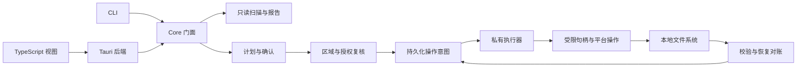

# 本地文件整理工具威胁模型与架构

当前实现提供只读扫描、分类、查重、目录授权、私有状态存储、操作计划、同卷移动与重命名、文件与目录校验复制、同卷隔离与恢复、批次与单项撤销、永久删除与隔离区清理、执行日志和恢复诊断。本文描述整体架构，并给出跨卷迁移与 GUI 的扩展设计。

目录遍历使用检查后的无跟随句柄枚举，授权设计包含目录位置建议。实现内容和验证结果见[测试说明](testing.md)。

采用 Rust 核心库、clap CLI、Tauri 2 与 TypeScript GUI。读取用户可访问的本地文件；文件修改由核心库统一检查授权并执行。扫描结果和分类规则只能提出建议，不能直接触发写入。默认软删除使用工具隔离区。

## 威胁模型

保护对象包括用户原文件、现有目标文件、敏感内容、授权边界、journal 和可恢复副本。输入包括不可信的文件名、符号链接、junction、规则文件、计划文件、IPC 参数，以及扫描后仍会变化的目录。

| 风险或故障 | 设计约束 |
| --- | --- |
| 错误规则、误选、误点、大规模整理 | before/after 预览，逐项选择，绑定计划的确认，大计划再次确认 |
| `..`、链接、重解析点、路径前缀伪装 | 规范化、按路径分量比较、拒绝遍历链接、目录句柄相对访问、执行时复核 |
| 并发创建同名目标 | 原子无覆盖发布；冲突后重新预览，禁止普通覆盖式 rename |
| 扫描后源文件被修改或替换 | 类型、身份、大小、修改时间及必要的内容指纹复核 |
| ENOSPC、配额、权限、占用、I/O 错误、断电 | 先持久化意图，校验后提交，逐步恢复，失败保留原件与明确状态 |
| 敏感内容被识别器、哈希器或日志读取 | 独立内容读取许可；B 默认仅元数据；不保存文件内容、预览缩略图或正文 |
| CLI 与 GUI 并发执行或重复提交 | 每个状态库单写者锁；批次和操作 ID 幂等；确认凭据单次使用 |
| 恶意文件名注入终端或 HTML | 展示时转义控制字符、换行、双向控制符；前端纯文本渲染；绝不拼接 shell |
| 本地网页或远程内容调用后端 | 无 HTTP 服务；仅打包前端；最小 IPC 权限、CSP；核心库再次授权 |

工具不提权，不调用 sudo，不请求管理员运行，不改变 ACL、所有者或系统安全设置来绕过拒绝。macOS 权限不足时说明失败原因和用户可自行设置的路径，不自动授予完全磁盘访问权限。

运行前提是操作系统、文件系统及本进程可信。应用内授权覆盖本工具的写入入口，操作系统权限负责账户与进程隔离。

句柄相对操作用于减少 TOCTOU。Unix 的身份比较与 unlink 分步执行，目录句柄也可能被外部进程搬迁；检测到身份、祖先、挂载或目录内容不确定时停止该项。永久删除执行路径须专项评审这一竞态窗口。底层缺少所需原子能力时返回 `UnsupportedSafetyGuarantee`。

## 区域模型是多项约束的交集

A、B、C 不作为可互相覆盖的单一枚举。每个路径分别得到：系统保护标记、敏感标记、授权归属、受保护整体归属、挂载身份、工具内部存储标记。**A 的写入拒绝优先；B 需要额外许可；C 授权不能覆盖 A 或自动解除 B。**

| 路径属性 | 名称、大小、时间 | magic 与重复哈希 | 作为复制源 | 移动、重命名、软删、永久删 | 作为写入目标 |
| --- | --- | --- | --- | --- | --- |
| A，且不是 B | 允许 | 普通本地文件允许 | 允许复制到 C | 一律拒绝 | 一律拒绝 |
| B，未授权为 C | 允许 | 禁止 | 仅逐项明确授权内容读取的复制 | 拒绝 | 拒绝 |
| B，同时属于 C | 允许 | 普通扫描和查重仍禁止 | 逐项内容读取确认 | 每项二次确认；仍受删除条件限制 | 每项二次确认 |
| C，非 A/B | 允许 | 允许 | 允许 | 预览确认后允许 | 预览确认后允许 |
| C 以外，非 A/B | 允许 | 允许 | 允许复制到 C | 拒绝 | 拒绝 |

只读来源无需授权；复制不能改变来源。移动的源与目的地必须分别有有效授权：C1 → C2 可以，C → 未授权目录直接拒绝。C1/C2 必须均显式授权；授权根目录本身不能被移动、重命名或删除，否则会破坏授权锚点。

### 区域 A

内置拒绝集合不可由 TOML、计划、命令行、持久授权或 GUI 绕过：

- Windows：`C:\Windows`、系统盘的 `Program Files`、`Program Files (x86)`、`ProgramData`，各本地卷根目录的 `$Recycle.Bin`、`System Volume Information`。另用系统 API 补充实际 Windows、Program Files 和 ProgramData 位置，覆盖非 C 盘安装；环境变量不能缩小拒绝集合。
- macOS：`/System`、`/Library`、`/Applications`、`/usr`、`/bin`、`/sbin`、`/private`。
- Linux：`/bin`、`/sbin`、`/usr`、`/lib`、`/etc`、`/boot`、`/dev`、`/proc`、`/sys`、`/var`、`/opt`、`/root`。系统别名须解析到相同保护对象。

启动时规范化存在的保护根；无法解析不表示解除保护，保留其绝对路径拒绝项并对不确定的写请求失败关闭。组件前缀不能用字符串 `starts_with`：`/usr2` 不属于 `/usr`。

别名检查结合规范化路径、卷身份和目录身份，覆盖 Windows 大小写、短路径、卷别名，macOS firmlink 与 Data 卷别名，以及 Linux bind mount。身份不明确的别名拒绝写入。规则文件可增加保护项。

### 区域 B

内置敏感目录覆盖 `~/.ssh`、`~/.gnupg`、浏览器配置和数据、密码管理器、系统钥匙串、Windows Credentials/Vault/Protect 等凭据目录、Local/Roaming/LocalLow AppData、`~/Library` 中的应用私有目录；Linux 另识别 `~/.config`、`~/.local/share` 下常见浏览器和密码管理器位置。

按原生文件名识别 `.env`、`.env.*`、`*.pem`、`*.key`、`id_rsa`、`id_ed25519` 等常见密钥名。密钥后缀的保守匹配可能有误报。用户可增加敏感目录；内置保护不能用规则解除。祖先敏感则子项敏感；无法确定时按敏感处理。

所有 magic、部分哈希、全哈希和文件复制前都必须先取得 `ContentReadPermit`。扫描器不能直接把任意路径交给 `infer::get_from_path` 或哈希器。B 默认不打开内容、不生成缩略图、不查重。整体目录包含 B 子项时，同样逐项显示并确认，不以“确认目录”代替所有子项确认。

对 B 的移动或重命名尽量不读内容。复制和跨卷移动必须读取内容并验证哈希，故确认界面必须写明本次读取范围、目的地及本地完整性指纹的保存；未同意则拒绝。此次许可仅用于该操作的复制、校验和对应恢复，不能用于查重、规则识别或其他项。撤销时如需重新读取 B 内容，重新逐项确认。

普通诊断日志对 B 使用操作 ID 和原因码，不写内容、哈希或路径。必要的原生路径、元数据及**显式授权内容操作后**的完整性指纹仅进入本地私有 journal，供定位和校验；不会保存文件正文、密钥、环境变量或内容片段。默认元数据扫描不产生这些内容指纹。

敏感识别依据常见名称、目录及已知文件身份，并将敏感标记传播到扫描清单中的硬链接别名。全局“仅元数据扫描”模式适用于所有文件的零内容读取需求。

### 区域 C 与工具状态存储

使用 `directories::UserDirs` 建议 Downloads、Desktop、Documents，不拼写本地化路径，不自动授权。授权分会话与持久，可查看和撤销。根必须已存在、非链接、可规范化；记录规范化原生路径、卷身份、目录身份、授权 ID、策略版本和授权代次。重新启动需复核身份；目录删除后重建、卷更换、身份不明均要求重新授权。

会话授权的有效能力仅在内存，退出失效；journal 可保留其历史授权 ID 和根作为审计资料，但绝不据此恢复会话授权。持久授权保存在显式批准的状态存储中。根目录授权不自动授权其挂载子卷。撤销与执行串行化，在安全检查点停止新操作；确认撤销完成后不得继续写该区域。已开始的单个系统调用无法追溯取消，界面必须等该检查点完成再显示“已撤销”。

**应用自身写入也需要授权。** 只读扫描默认只输出 stdout/stderr，无自动扫描缓存、文件日志或持久报告。未来的报告导出同样是写入计划，不能任意写到未授权路径。

首次持久化先显示内部存储初始化计划，由用户在非 A/B 的 C 中选择 `<C>/.file-tidy/`，明确创建状态库、配置、锁、审计快照及 SQLite 辅助文件的用途。初始化受限于专用 `StorageInitPermit`，不先写状态再询问。系统推荐的应用数据目录若落在 B，不自动启用；优先让用户选择非敏感授权目录，避免 journal 自身反复触发 B 确认。

内部文件写入使用受限的 `ManagedStoragePermit`，范围仅已展示并授权的内部对象及文件用途，不接受前端自由路径。用户文件整理入口不能操作工具状态、journal、锁、配置或其祖先。内部隔离区只能经隔离区管理入口操作。根目录的授权撤销需先完成 journal 落盘和数据库关闭，再确认撤销；无法持久化撤销结果则不报告成功。

这区分了“已授权操作的内部记录”与“用户文件修改”：每次 journal 更新不再次弹窗，但不能超出首次明确同意的内部存储用途。调整存储位置也要单独预览确认。

## 路径与对象身份

运行期仅用 `Path`、`PathBuf`、`OsStr`、`OsString` 操作路径。展示字符串永不用于反向构造执行路径。CLI 用 `args_os`/clap 的 PathBuf 参数接收路径。

`PathRecord` 在 journal 和计划中使用带平台标签的无损编码：Unix 原始字节；Windows `encode_wide()` 的 UTF-16 code units，以小端字节 BLOB 保存，包含无法表示为正常 Unicode 字符串的情况。拒绝跨平台直接执行导入的计划。JSON 对外展示 `entry_id` 与转义文本；需要无损导出时另附平台编码和原始整数数组。前端不把展示文本回传为源路径，大整数大小使用十进制字符串。

普通已存在对象先 `symlink_metadata` 检查类型与 reparse 属性，再规范化进行策略判断。执行使用已验证的父目录句柄和单个叶子名称。目的地不存在时，规范化最近存在的父目录；后续分量逐个验证，拒绝绝对路径替换、`..`、链接及跨挂载，缺失目录的创建也纳入计划。

**删除链接的特例**：规范化并验证其父目录，检查叶子确为链接，再只删除叶子目录项；不 canonicalize 后去删除目标。断链也适用。父目录为 A 则拒绝；父目录为 C、叶子指向 A 时，只删除链接本身可以被明确计划和确认。普通扫描、哈希及递归删除均不进入链接。

Windows 必须对 `symlink_metadata` 的 `MetadataExt::file_attributes()` 显式检查 `FILE_ATTRIBUTE_REPARSE_POINT`，不能只用 `is_symlink`。junction、卷挂载点、云占位等重解析对象一律不递归、不哈希；只有已识别且经过测试的普通符号链接可走“删除链接本身”，未知 reparse tag 拒绝修改。[Rust MetadataExt](https://doc.rust-lang.org/std/os/windows/fs/trait.MetadataExt.html)、[Microsoft CreateFileW](https://learn.microsoft.com/en-us/windows/win32/api/fileapi/nf-fileapi-createfilew)。

Windows 生成目标名时拒绝保留设备名、非法字符、NUL、结尾点或空格、ADS 冒号；拒绝原始设备命名空间和未明确支持的命名空间。保留必要的 `\\?\` 长路径形式，`dunce` 仅作兼容辅助，不能充当授权检查。扩展长度路径并不自动允许绕过名称政策。[Microsoft 命名规则](https://learn.microsoft.com/en-us/windows/win32/fileio/naming-a-file)。

macOS 的 NFD/NFC 只用于搜索、排序和潜在冲突提示；不重写原始名称。大小写敏感性按目标卷/目录实际行为处理，不能全局小写比较。授权包含关系结合目录身份；最终同名判断由文件系统的原子独占操作裁定，不能只靠 Unicode 或大小写折叠。

## 能力式文件系统与平台隔离

选择 `cap-std::fs::Dir` 作为已授权目录句柄的基础，采用非 UTF-8 限制版本。授权、内容读取、执行和恢复分别持有必要能力，非执行模块不能取得通用写能力。`ambient_authority` 仅在核准根的打开边界使用。[cap-std 设计](https://docs.rs/cap-std/4.0.3/cap_std/)。

cap-std 提供目录句柄相对访问；core 负责区域、授权和确认，平台层负责挂载边界与原子无覆盖操作：

- Linux：优先使用 `openat2` 的 BENEATH、NO_SYMLINKS、NO_MAGICLINKS、NO_XDEV 约束；无覆盖移动用 `renameat2(RENAME_NOREPLACE)`。bind mount 可能同设备号，不能只比较 `st_dev`。[openat2](https://man7.org/linux/man-pages/man2/openat2.2.html)、[renameat2](https://man7.org/linux/man-pages/man2/rename.2.html)。
- macOS：以目录 fd 相对打开并逐级 no-follow，结合挂载表和对象身份；无覆盖 rename 使用 `renameatx_np`/`RENAME_EXCL` 一类平台机制。卷支持、fd 包装和文件系统行为随写入功能验证。[Apple 独占重命名能力](https://developer.apple.com/documentation/foundation/urlresourcevalues/volumesupportsexclusiverenaming)。
- Windows：句柄打开、OPEN_REPARSE_POINT、最终路径和文件身份复核；源句柄重命名使用不替换已有目标的 `FILE_RENAME_INFO`，目标相对目录句柄。共享模式和文件系统差异列入原生平台测试。[Microsoft FILE_RENAME_INFO](https://learn.microsoft.com/en-us/windows/win32/api/winbase/ns-winbase-file_rename_info)。

不支持所需原子无覆盖操作时拒绝该写入；不得用 `exists()` 后 `std::fs::rename()` 兜底，因为标准 rename 允许覆盖已有文件。[Rust rename](https://doc.rust-lang.org/std/fs/fn.rename.html)。

`file-tidy-core` 使用 `#![forbid(unsafe_code)]`。如需 FFI，必须放在独立的 `file-tidy-platform` crate；同 crate 的子模块不能覆盖 `forbid`。优先使用 rustix 等安全封装；剩余 Windows/macOS FFI 只提供小型安全接口，每处 unsafe 写明句柄寿命、缓冲区布局和长度不变量，单独审计。平台适配层不提供能被 GUI 直接调用的任意路径删除命令。

## Workspace 与模块边界

Workspace 目标结构如下，模块按功能引入：

```text
Cargo.toml                         workspace，默认成员 core/cli
Cargo.lock                         实际解析后提交
crates/
  core/src/
    lib.rs                         forbid unsafe
    error.rs                       thiserror 与稳定原因码
    path.rs                        无损编码、对象身份
    policy/{protected,sensitive,atomic}.rs
    authorization.rs               GrantStore、内容与写能力检查
    scan.rs                        遍历、进度、取消
    classify.rs                    内置规则与 TOML
    duplicates.rs                  大小→部分→全量 BLAKE3
    report.rs                      Top N、陈旧、重复、遗漏原因
    plan.rs                        无副作用的计划、选择与预览
    approval.rs                    挑战、确认与计划绑定
    execute.rs                     私有写入编排
    journal.rs                     SQLite 与事件
    recovery.rs                    崩溃对账
    undo.rs                        生成逆向计划
    quarantine.rs                  隔离清单、恢复与过期提醒
  core/tests/                      临时目录与故障注入集成测试
  platform/src/{lib,linux,macos,windows}.rs
  cli/src/main.rs                  clap，仅调用 core 门面
  gui/
    src-tauri/                     Tauri 后端、permissions、capabilities
    src/                           TypeScript 可视化与交互
docs/                              当前设计与后续用户文档
.github/workflows/ci.yml            三平台构建与检查配置
```

除了要求的 core、cli、gui，增加 platform crate 是为了真正隔离可能必需的 unsafe。GUI 不进入 CLI 默认构建，避免只用 CLI 时安装 WebView 工具链。core 没有 Tauri、前端、HTTP、shell 或 GUI 依赖。



所有用户文件修改，包括自动重名、临时文件创建、复制校验后的源删除、回滚删除副本、恢复目录创建、隔离区清理，都必须从 core 门面进入并取得相应写能力。底层执行模块、能力构造器和原始后端不作为公共 API 导出。规则只能映射相对分类目录，不能包含任意绝对写路径或执行脚本。

## 核心数据模型

核心类型设计如下：

| 类型 | 必要字段或约束 |
| --- | --- |
| `FileEntry` | EntryId、PathBuf、FileKind、逻辑大小、可选实际分配大小、时间、扩展名、卷/文件身份、PolicyLabels、可选类型证据 |
| `Fingerprint` | no-follow 类型、卷/文件身份、长度、原始精度修改时间、可选 change-time、链接数、必要时 BLAKE3；字段不可用须显式表达 |
| `Grant` | GrantId、根原生路径、根对象身份、会话/持久、代次、撤销状态；无可伪造的通用 bool 授权 |
| `PolicyLabels` | protected、sensitive、atomic_owner、hidden、mount、managed_storage，各自独立 |
| `Plan` | 格式版本、PlanId、策略摘要、授权代次、创建与过期时间、不可变选中操作、总项数/字节、目录清单与快照摘要 |
| `PlannedOperation` | OpId、操作类型、source、destination、before、after、源指纹、目标父身份、冲突改名、目录 manifest、所需许可、不可撤销标记 |
| `DirectoryManifest` | 全部相对原生路径、节点类型、身份、大小、修改时间、链接本身信息；排序后摘要；遍历不完整则禁止目录操作 |
| `ApprovalReceipt` | 计划摘要、选中 OpId 集合、风险层级、逐项 B 许可、授权代次、短期有效期、单次 nonce；由核心核验，不反序列化为写能力 |
| `OperationResult` | done/skipped/failed/needs_recovery、阶段、原因码、可读原因、实际目的地、journal 引用 |
| `QuarantineItem` | 批次、OpId、原位置、隔离位置、完整性指纹/manifest、保留到期时间、stored/restored/purged 状态 |

门面提供 scan、report、build_plan、review、confirm、execute、build_undo_plan、list_quarantine、build_restore_plan、build_purge_plan。执行器只接受核心封装的 ApprovedPlan；导入 JSON/TOML 不能构造该类型。每条执行仍检查当前授权，不信任扫描或持久化的旧判断。

所有求和与序列号运算检查溢出。文件路径与来源指纹无损持久化；UI 的 EntryId 只能查找后端持有的对象。库层定义 `ProtectedZone`、`OutsideGrant`、`SensitiveConsentRequired`、`ChangedSincePlan`、`DestinationConflict`、`InsufficientSpace`、`UnsupportedNode`、`IncompleteManifest`、`JournalUnavailable`、`NeedsRecovery` 等 thiserror 变体，保留 I/O 错误链和稳定原因码。库生产代码禁用 unwrap、expect、panic；CLI 仅在边界用 anyhow 补充上下文。

## 扫描 分类 查重 报告

目录枚举使用 platform 的无跟随目录句柄，先检查 reparse、挂载和特殊类型，再枚举子项。普通本地文件交给受内容许可保护的 worker。有界 Rayon 线程池并行采集元数据、类型与哈希；限制排队数、打开文件数及每卷 I/O 并发，取消标记在遍历和每个流式读取块间检查。

全盘模式先枚举本地卷，再每卷作为独立扫描任务；单个任务不跨挂载点。子挂载点记入报告，并可作为独立根扫描。网络盘、UNC 网络共享、云占位、自动挂载点及本地性不明的文件系统默认跳过并记录原因。

Unix 设备、FIFO、socket 不打开、不哈希。Linux `/proc`、`/sys` 等虚拟文件系统也按特殊文件系统排除内容读取，不能因显示为普通文件就尝试读。A 本身不会导致普通本地文件从报告消失；显示只读标记。权限和文件占用错误逐项收集，不使用 `filter_map(Result::ok)` 吞掉错误。

进度报告发现项数、已处理项数、已读字节、当前阶段和错误数；遍历完前不伪造精确百分比。取消后报告带 incomplete 标记；不将未扫描项视为 0 字节或没有重复。

分类规则为 TOML，支持文档、图片、视频、音频、压缩包、代码、安装包、其他，按年/月与项目来源附加维度。类型证据保留“扩展名/魔数/冲突/未知”；规则是建议，不把魔数当完整解析器。默认最多读前 16 KiB 作类型证据；B 不读。时间按修改时间，不能把修改时间当最后使用时间。陈旧默认超过 365 天可配置，只报告。

查重顺序：同大小、不同文件身份的普通文件 → 前 64 KiB BLAKE3 → 全量流式 BLAKE3。B 永远不进入普通查重；硬链接合并计数，不当作可释放空间副本。读取前后复核身份和元数据，变化则排除并说明。空文件单独分组。默认不使用 mmap，减少正在截断文件的风险。重复结果不自动产生删除计划。

空间报告区分逻辑大小与可取得的实际分配大小；稀疏文件、硬链接、压缩、APFS clone/reflink 不把逻辑字节直接当可释放空间。Top N、目录聚合、陈旧、重复和跳过原因都可追踪到条目；GUI 用这些聚合绘制树图，无法计算的部分标未知。

## 受保护整体与隐藏项

祖先含 `.git`、`.hg`、`.svn` 标记（目录或 worktree 标记文件均算），以及 node_modules、venv、.venv、target、__pycache__，自动标记项目/依赖整体。识别 `.app`、数据库及伴随文件、VM 包/镜像、容器镜像与存储目录。扫描可在边界允许时观察内部，但自动整理不能拆开内部项。

手工选择内部项同样拒绝，提示选择完整根对象。对整体操作显示明确警告和实际展开清单，逐项检查隐藏、B、A、挂载与工具存储。移动父目录不得间接搬走受保护内容。数据库复制与跨卷移动要求对象静止且伴随文件完整；条件不满足时拒绝操作，并提示先关闭所属应用。

隐藏标记同时考虑点文件与 Windows hidden 属性。默认不进入整理计划。目录含隐藏子项时不能悄悄把它们随父目录搬走或删除：该整体计划要求显式启用隐藏项并展示全部子项，否则拒绝。对选中的项目整体也适用。

## 计划与确认契约

build_plan 只读取文件系统，不 mkdir、不创建临时文件、不预约目标名、不写 journal。计划编辑完成后，确认步骤才将快照持久化到已授权内部存储；批量删除必须在首条修改前保存成功。快照失败则零执行。

预览展示树状 before/after、原生路径的转义显示、每项类型/大小、源与目的区域、自动重名、需创建目录、涉及 B/项目/隐藏项的提示，以及可撤销程度。目录操作必须可展开完整清单，终端滚屏不能替代永久删除的完整清单审阅。

普通单文件也要明确确认。CLI 的交互确认由 stdin/TTY 收取，不以默认 yes 代替；确认流程采用交互输入。GUI 执行按钮只提交已展示的快照 ID 和确认响应。确认凭据绑定原始快照字节的 BLAKE3、选中集合、动作、目的地、策略版本、授权代次和有效期，默认 15 分钟。增删勾选、目标变更、重新命名或阈值变化都使凭据失效。

候选冲突名在预览阶段计算为 `name (1).ext`，多重扩展名按明确规则保留，例如 `archive (1).tar.gz`。命名只能操作 OsString 原生分量。执行期间目标被占用，则跳过并提供重新生成计划；不能静默变成尚未展示的 `name (2).ext`。命名长度超限则清晰报错，不擅自截断。

默认二次确认阈值是产品初值，可在配置中降低并在 UI 显示；永久删除不能配置得比普通操作更宽松：

| 级别 | 触发规则 | 确认 |
| --- | --- | --- |
| 所有普通修改 | 任意条数 | 审阅快照后明确确认 |
| 大计划 | 实际叶子文件/链接数 > 100，或逻辑总大小 > 10 GiB | 再输入实际文件数；目录不可仅算一条 |
| B 写入或内容操作 | 每个敏感项 | 强警告后逐项确认，不能“全部同意” |
| 任意永久删除 | 任何大小，且显式 `--permanent`/专用 GUI 入口 | 完整清单、总大小、“不可撤销”，输入 `PERMANENT <数量> <挑战码>` |
| 大规模永久删除 | 实际文件/链接数 > 10，或总大小 > 1 GiB | 额外独立审阅并再次输入文件数；无法人工核对则拒绝执行 |

统计另列目录数、未知大小和硬链接；空目录也有独立确认项。B 和永久删除的二次确认分别校验。挑战码由系统随机数产生，凭据绑定本次应用流程并单次使用；日志只记确认范围、时间和摘要。

## 复制与发布协议

1. 检查当前源及目标父目录策略、授权代次、对象类型和指纹；复制源可以只读位于 A/C 外，目的地必须 C 且非 A。
2. 查询当前用户在目标卷的可用空间，以本批最坏逻辑大小、暂存峰值和预留量估算，至少保留 `max(64 MiB, 预计写入量的 5%)`。配额、压缩与竞争写入无法靠预检保证，后续仍正确处理 ENOSPC。
3. 持久化 Prepared 及临时名称意图，然后在目标授权目录内部以独占创建方式生成随机 `.file-tidy-<opid>.part`；登记文件身份，不用系统全局临时目录。
4. 从已验证的源句柄流式读取并计算完整 BLAKE3，写入临时文件。中断检查按读取块进行。不跟随链接、不复制设备、socket 或 FIFO。
5. flush、sync 后重新读取目标计算哈希，核对源/目标长度与完整哈希，再检查源身份、大小、修改时间未变。发现变化则该项失败，不能将部分结果发布。
6. 保留修改时间和普通权限，并逐项记录结果。排除 setuid/setgid、所有者变更和权限扩张。ACL、xattr、资源叉、NTFS ADS/压缩/稀疏属性按平台能力检查；必要元数据无法保留时拒绝跨卷移动，普通复制按预览中的策略报告结果。扩展属性列入平台验证矩阵。
7. 校验完成后以原子无覆盖 rename 发布临时文件，sync 文件与可支持的父目录，持久化 Published/Done。发布不覆盖现存目标。
8. 发布前失败则只清理由本次创建、身份相符且仍获授权的半成品；清理失败记录待恢复项。进程崩溃后依据 journal 对账，归属不明的 `.part` 留待人工处理。

目录复制先取得完整 manifest，在私有暂存目录中构建整棵树，所有普通文件校验后才发布根；任何子项变化或失败使整体不发布。跨卷复制含链接的目录依赖“不跟随、仅重建链接”的平台能力；缺少该能力或需要管理员权限时拒绝整个目录复制。

同卷复制也执行大小与哈希校验。活跃对象执行破坏性迁移前须先取得一致读取条件。

## 移动与重命名协议

同卷使用平台原子无覆盖 rename；重命名是同目录移动的特例。大小写更改可能需要一个已展示的内部临时名称，两步都写 journal；失败或崩溃可对账，不能覆盖已有对象。

跨卷回退只由**实际 rename** 的跨设备错误触发：Unix EXDEV、Windows ERROR_NOT_SAME_DEVICE，使用平台常量/结构化错误，不硬编码数字或匹配错误字符串。不能把 no-follow/openat2 的逃逸拒绝产生的 EXDEV 当作回退许可，也不能因权限错误而回退。

普通文件：copy → 完整校验与持久化目标 → 再次复核源 → 持久化 SourceRemoveIntent → 删除源目录项 → sync 源父目录 → Done。源删除以前的任何失败都保持源原样；删除失败时源仍在，已完整校验的副本可保留并标部分完成，不能当未完成的半成品误删。删除成功之后是提交点，journal 最后更新失败应标 NeedsRecovery，对账后完成，不能误报“失败且原件仍在”。

**跨卷目录的额外约束**：递归删除源不能保证“删到一半失败仍保持原样”。因此采用完整复制校验后，把源根以同卷原子 rename 移入源授权区隔离区，作为移除原路径的提交点；保留源快照以支持恢复，空间要到显式清理隔离区才释放。隔离区不存在或未授权时拒绝，不能自行递归删源。预览须显示源隔离快照与空间释放条件。跨卷目录移动依赖隔离管理功能，普通文件跨卷移动使用独立协议。

目录整体操作先展开并检查所有后代，包括不能移动的授权根、挂载点、A/工具存储。源与目标不能互为祖先，父子重叠计划、循环改名与目标冲突先拒绝并解释，不试图自动解开复杂依赖。

## 删除 隔离区与恢复

默认隔离区为每个授权根的 `<C>/.file-tidy/quarantine/<batch>/<op>/payload`，原名无损保存在 journal。隔离区与来源同卷，源目录含嵌套挂载则拒绝。首次创建属于预览中的操作，不能先创建后询问。同卷 rename 保留原对象元数据，也使软删除不会越出授权 C；创建后作为受保护内部存储，普通整理不能移动/删除它及其祖先。

保留期默认 30 天，可配置。到期只提醒，不自动永久删除。提供按批次列出、恢复、逐项恢复、待清理提醒、手动清空。恢复也生成 before/after 计划、检查当前授权；原路径已占用先计算新名并再次预览，绝不覆盖。原授权撤销或卷离线时等待重新授权/接入，不借旧 journal 绕过当前规则。

删除硬限制同时适用于目录祖先操作：所有挂载根、授权根、工具数据、journal、隔离区以外的配置均不可删除；隔离区根也不可作为普通删除对象，purge 仅作用于受管理的 payload。不能通过删除父目录间接删掉这些对象。

删除目录时保存全部子项 manifest；执行前重新完整枚举并比较，包括空目录、隐藏项与链接。遍历失败或任何新增、删除、类型、身份、大小、修改时间变化均使整条目录操作作废。无权限读取某子项时不能先删其他子项。所有叶子仍逐条复核，不调用不透明的通用 `remove_dir_all` 处理不可信路径。

永久删除只允许受管理隔离 payload，或用户明确使用 `--permanent` 的授权 C 内对象；两类均需完整清单与强确认。A、B、挂载与根保护均在执行时复核。隔离 payload 若被外部替换或加入未知文件，需要重新生成清单并确认。永久删除移除目录项，数据擦除另属存储设备能力。递归删除逐叶记录结果，取消或错误时保留已完成与未处理清单。授权目录内的永久删除先将完整源对象移入已预览的同卷私有载荷位置，再逐叶删除；隔离区清理直接处理已登记的载荷。每个删除意图与隔离项的待核对状态在同一事务中提交，结果与条目状态同步登记。Unix 使用父目录句柄相对 unlink，Windows 使用已核验的 DELETE 句柄。部分删除后的恢复通过新的尚存清单计划确认。

软删除使用工具隔离区。系统回收站与 `trash` 保留为候选方案，引入前单独评审各平台落点、恢复 API 及区域授权。

## Journal 与崩溃恢复

| 方案 | 优势 | 成本与选择 |
| --- | --- | --- |
| append-only 文件 + fsync | 记录格式可直接审阅、追加简单 | 要自行实现截断检测、校验、索引、锁、恢复、迁移；本工具不选 |
| SQLite WAL + FULL | 读写并行好，事务成熟 | 要管理 WAL/SHM、检查点与一致备份；当前没有并行数据库读取需求，暂不选 |
| SQLite rollback journal DELETE + EXTRA | 事务、约束、迁移成熟，单写者下流程简单 | 短事务有同步成本；**本工具选择**，优先正确性 |

使用 rusqlite，SQLite `foreign_keys=ON`、`journal_mode=DELETE`、`synchronous=EXTRA`；macOS 探测并开启 fullfsync。设置后读取验证实际值，不能把无效 pragma 当成功。数据库及辅助文件只在授权且私有的状态目录内创建，不在网络文件系统上使用。SQLite 的 EXTRA 在 DELETE 模式下比 FULL 多做 rollback journal 删除后的目录同步。[SQLite synchronous](https://www.sqlite.org/pragma.html#pragma_synchronous)。

SQLite 管理状态记录，rename/copy/unlink 由文件系统执行。两者通过**意图先落盘，再执行，再核对落盘**的协议衔接：

```text
Planned -> Prepared -> Staged -> Verified -> Published -> SourceRemoveIntent -> Done
                 \-> Skipped / Failed / NeedsRecovery
```

不同操作只经过适用的状态：同卷 rename 从 Prepared 到已发布/源已移除；复制没有删除源阶段；跨卷普通文件必须先 Published 再 SourceRemoveIntent；永久删除逐叶记录 intent/done。单独的操作事件表保存实际步骤，不能只用最后一个状态推断。

首次修改前事务保存 sealed 计划快照、策略摘要、选中集合和确认审计；每个物理步骤前记录预期对象和恢复信息并提交；成功后先同步文件/目录再提交结果。数据库出错或无可用空间则停止后续项。批次按操作记录完成状态，永久删除的已完成项保留为不可撤销结果。

恢复程序启动时只读检查未完成事件及实际对象，先出恢复计划，不静默执行新的破坏性动作：

| 已持久化状态与现场 | 判定 |
| --- | --- |
| Prepared，源符合，目标没有 | 还未提交；可重新预览执行 |
| 私有半成品身份符合 | 生成续传或清理计划；默认清理重做，不把它当完整文件 |
| rename 之后、Done 之前崩溃 | 目标身份与预期一致且源缺失时补记结果；不重复 rename |
| 复制目标完整，源仍在 | 区分复制完成/跨卷移动尚未删除源；源删除需重新复核授权并确认 |
| 目标完整，源缺失 | 按意图与身份核对已完成迁移；journal 补记，不制造第二份动作 |
| 源或目的均变化、两者均缺失、身份不足 | NeedsRecovery，保存证据并提示用户处理，不猜测、不自动删除 |
| 永久删除 intent 后崩溃 | 缺失项记录“现在缺失，删除结果待对账”，标记为不可撤销 |

数据库补记需要当前内部存储许可。原授权失效则只读诊断，等待重新授权。历史快照用于审计，跨会话执行重新验证当前授权。日志保存在用户私有状态目录。

数据库表格式见 [journal.sql](journal.sql)。计划快照用版本化的固定结构 JSON 字节 BLOB，原生路径用平台编码的整数数组；摘要针对**保存的精确字节**，不依赖任意 JSON 重排等价性。导入后重新验证全部字段；不相信外部摘要、确认记录或历史指纹。批次、操作和事件保留本地路径，Unix 目录/文件权限目标 0700/0600，Windows 使用用户私有 ACL；实际平台行为待测试。

## 撤销语义

撤销生成新的逆向计划，重新预览确认，经过当前区域检查并追加 journal；不修改原审计事实。整批按依赖的逆序构造，单条撤销若被后续操作依赖则拒绝并解释。

- 同卷移动/重命名：目标仍是原对象且未变化时移回；旧位置冲突先生成无覆盖新名并预览。
- 跨卷移动：已验证的目标复制回原授权位置并校验，再把目标副本移入其授权根内隔离区；跨卷目录可利用源隔离快照，但源快照和目标树均要复核。
- 复制：只删除本工具创建、身份/类型/大小/时间及完整哈希均符合记录的副本；默认通过移入授权根内隔离区移除副本原路径，不悄悄进行永久 unlink。目录还要完整 manifest，新增文件使整条撤销拒绝。副本被修改、换成同名同内容新对象或无法核实身份时拒绝；B 重新逐项确认。最终释放隔离空间仍走永久删除流程。
- 软删除：隔离 payload 验证后恢复，不能覆盖。
- 永久删除：明确不可撤销，不提供可点击回滚。

内部隔离原语用于副本撤销，通用隔离管理提供软删除、保留期和恢复。永久删除采用独立的审阅与确认流程。

恢复与撤销先核验文件状态、当前授权和介质可用性；校验失败时保留现有数据并返回原因。永久删除标记为不可撤销。

## GUI 与本地隐私

Tauri 2 后端直接调用 core，不启动本地 HTTP 服务。仅打包资源，拒绝远程导航和远程 IPC；不使用 fs、shell、HTTP、updater 等通用插件暴露文件系统或网络。开发期 Vite 服务不进入发布运行时。

只启用 main 窗口及显式列出的应用命令权限，范围为扫描/取消/报告分页、计划审阅/确认/执行、授权管理、隔离列表/恢复、撤销。永久删除使用独立命令与风险页面。通过 AppManifest 命令清单生成并显式授予所需 invoke 权限，命令名称和 schema 在 GUI 构建时验证。[Tauri capabilities](https://v2.tauri.app/security/capabilities/)。

前端只传对象 ID 和结构化意图；新增目标目录只能走受校验的路径选择/授权流程，不能用通用 `write_file(path, data)`。CSP 禁远程脚本、资源和外部连接，仅放行实际必需的 Tauri IPC 源；不把磁盘 HTML、SVG、数据库、压缩包或文件内容装进 WebView，不以名称拼 HTML。[Tauri CSP](https://v2.tauri.app/security/csp/)。

界面至少包含：

1. 空间页：可缩放矩形树图/旭日图、大小口径、Top N、陈旧与重复入口，单项路径可定位。
2. 计划页：树状 before/after、逐项选择、总数/大小、来源和目标区域、警告及不可撤销说明。
3. 授权页：系统推荐目录、会话/持久、实际规范化位置与卷、撤销、A/B 标记。
4. 隔离与历史页：批次、30 天到期提醒、恢复和撤销、部分失败与恢复处理。
5. 永久删除专用页：红色危险按钮、文字“永久删除 不可撤销”、完整清单与二次输入；不用颜色作为唯一提示。

产品在本地处理文件，运行期间无外部连接、遥测或自动更新。构建与依赖审计使用开发环境网络。文件访问遵循所在系统的 atime 和目录同步机制。

## 功能扩展设计

| 功能 | 设计重点 |
| --- | --- |
| 授权与计划 | 状态初始化、目录清单、逐项选择、无覆盖命名与确认绑定 |
| 文件操作 | 原子移动与重命名、校验复制、跨卷处理、journal、恢复与撤销 |
| 隔离管理 | 每授权根隔离、软删除、批次恢复与保留期提醒 |
| 永久删除 | 专项设计评审、独立确认、逐叶记录与故障测试 |
| 图形界面 | Tauri/TypeScript、空间可视化、计划审阅与 IPC 权限 |
| 平台与打包 | 三平台 CI、原生文件系统场景、权限检查与依赖审计 |

Windows junction、长路径、回收站与 ACL 使用原生平台场景验证。

关键设计选择：C 内隔离存储、首次授权的内部状态、SQLite DELETE/EXTRA 与文件系统意图日志、目录句柄与平台原子操作，以及跨卷目录的同卷隔离提交。
